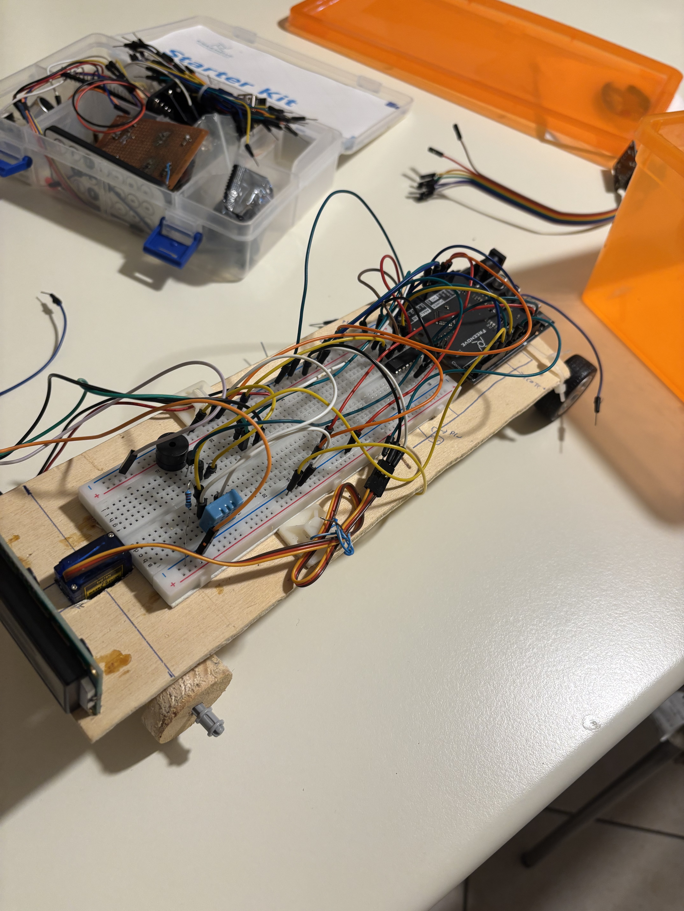
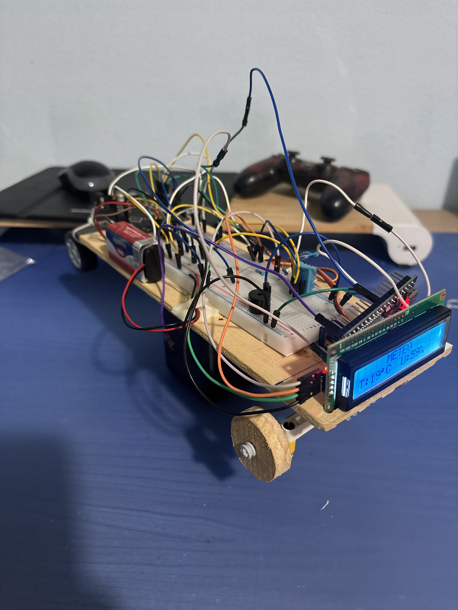
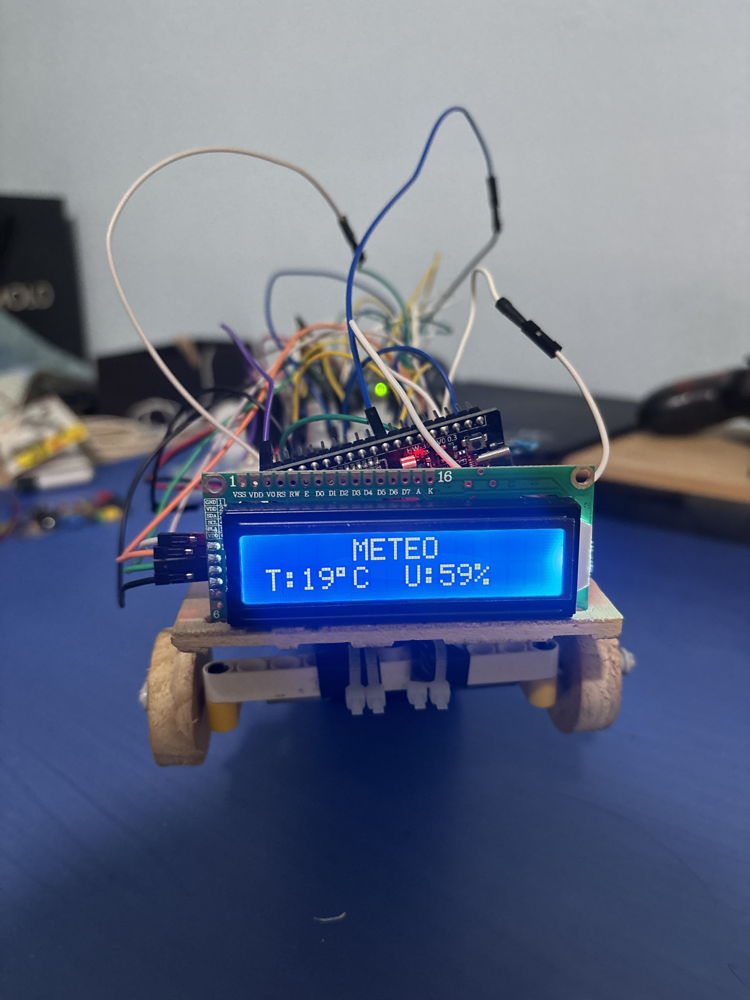
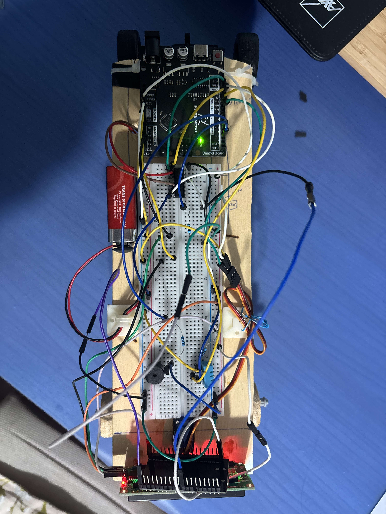
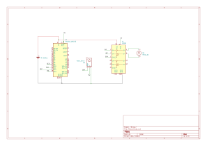
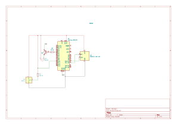
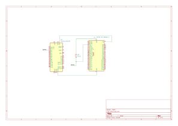

# 🚗 Arduino RC Car with ESP32 Wi-Fi Control

A rear-wheel-drive remote-controlled (RC) car powered by an **Arduino Uno** and an **ESP32** Wi-Fi receiver. The car features PWM speed control, servo-actuated steering, an active horn, an onboard DHT11 weather station displayed on an I2C LCD, and an automated failsafe system that halts the vehicle if Wi-Fi connection is lost.

---

## 📸 

|CAR | OVERVIEW|
| :-: | :-: |
|  |  |
|  |  |

---

## ⚡ Key Features

* **Wireless Wi-Fi Control**: Commands received through an ESP32 communicating via `SoftwareSerial` to Arduino and REMOTEXY to the smartphone
* **L293D H-Bridge**: Full control of the motor directions and speed
* **Safety Failsafe Mechanism**: If communication is interrupted, the car instantly stops
* **Onboard Weather Station**: Reads ambient temperature ($^\circ\text{C}$) and relative humidity ($\%$) via a **DHT11** sensor.
* **16x2 I2C LCD Dashboard**: Real-time onboard display showing weather over a 2-wire I2C bus.
* **Integrated Horn**: Active buzzer triggered directly from the controller.

---

## 📐 Circuit Schematic

### Component list

| Component | Model |  
| :--- | :--- 
| **Microcontroller** | ARDUINO UNO | 
| **WiFi Access Point** | ESP32 | 
| **Motor driver** | L293D | 
| **Servo** | SG90 | 
| **Sensor** | DHT11 | 
| **Display** | LCD I2C 16x2 | 
| **Generic** | resistors, transistor,  buzzer | 

---

## 📡 Serial Communication Protocol

The ESP32 sends control packets to the Arduino over serial at **9600 baud** using start/end delimiter framing:

$$\texttt{<X,Y,Horn>}$$

| Field | Range | Description |
| :---: | :---: | :--- |
| **`X`** | `-100` to `+100` | Steering angle (`-100` = Full Left, `0` = Center, `+100` = Full Right) |
| **`Y`** | `-100` to `+100` | Throttle (`-100` = Full Reverse, `0` = Stop, `+100` = Full Forward) |
| **`Horn`** | `0` or `1` | Horn trigger (`0` = Off, `1` = Sounding) |

**Example packet**: `<0,75,0>` commands the car to steer straight, drive forward at 75% throttle, with the horn off.

---

## 💻 Software & Libraries

The project is configured for **[PlatformIO](https://platformio.org/)** on VS Code. Dependencies are handled automatically via [`platformio.ini`](platformio.ini)
